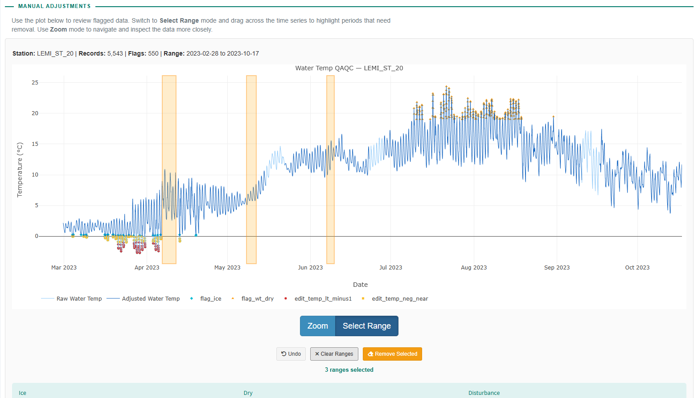

# waterlogged Shiny Application

**Standardized and efficient processing of environmental data from continuous data loggers**

waterlogged is a data processing application for water data from continuous water data loggers. The goal of waterlogged is to make aquatic environmental data processing more streamlined, standardized and accessible to a wide range of users.

This version of the package was built for data from Onset HOBO barometric pressure (U20), dissolved oxygen (U26), conductivity (U24), and TidbiT loggers.

## Workflow Overview

This application guides you through a sequential workflow for processing your water logger data:

| Processing Stage | Package Functions |
|------|----------|
| Join and Trim Raw Logger Files | `bind_logger_files()` |
| Add Barometric Data to Logger Files* | `add_nearest_baro()` |
| Metric Conversion* - Convert logger metrics (i.e. apply barometric compensation) | `convert_waterlevel_kPa_m()`, `convert_do_mgl_percsat()` ,`convert_conductivity_spc_uScm()` |
| Automated Quality Control - Remove outliers and flag data for review | `qc_waterlevel()`, `qc_dissox()`, `qc_conductivity()` , `qc_barometric`, `qc_airtemp`, `qc_watertemp` |  
| Manual Review and Adjustments - Remove or correct outstanding data errors | `adjust_logger_NA` , `adjust_waterlevel_offset`, `adjust_waterlevel_spike`, `adjust_waterlevel_zero`, `adjust_waterlevel_datum`|
| Export Clean Logger Data - Standardized naming and file organization | `write_clean_data()` |
| Summarize Data - Produce daily, monthly, yearly summary statistics | `summarise_clean_data()` |
| Visualize Data - Produce report-ready summary figures | `plot_clean_timeseries()` |
|------|----------|
*Indicates optional processing stage (i.e. not applicable for all logger data)




## Supported Loggers

| Logger | Metric |
|--------|--------|
| HOBO U20 | Water Level |
| HOBO U20 | Barometric Pressure |
| HOBO U26 | Dissolved Oxygen |
| HOBO U24 | Conductivity |
| HOBO TidbiT | Temperature |

## Documentation & Tutorials

- [waterlogged R package manual](inst/misc/documentation/waterlogged_manual.pdf)
- [Tutorial: Barometric timeseries](inst/misc/documentation/barometric-pressure.pdf)
- [Tutorial: Water level timeseries](inst/misc/documentation/water-level.pdf)
- [Tutorial: Dissolved oxygen timeseries](inst/misc/documentation/dissolved-oxygen.pdf)
- [Tutorial: Conductivity timeseries](inst/misc/documentation/conductivity.pdf)

## Getting Started

1. Navigate to **Upload Data**
2. Follow each step in sequence
3. Review instructions and examples
4. Process and visualize your data

## Running the Application

```r
shiny::runApp()
```

## Repositories

- R package: [github.com/dfo-pacific-science/waterlogged](https://github.com/dfo-pacific-science/waterlogged)
- Shiny app: [github.com/dfo-pacific-science/waterlogged-shiny](https://github.com/dfo-pacific-science/waterlogged-shiny)

## Authors & Contributors

**Department of Fisheries and Oceans, Canada**

**Authors/Developers:** Daniella LoScerbo, Amanda Martens, Julian Gan, Paula Soto

**Project Supervisors:** Douglas Braun, Sean Naman, David Reid, Joel Harding

**Technical Support:** Matthew Bayly (MJBA, App Development), Frank Poulsen (Ashlu, Technical Support)

The correct citation for this Shiny App and associated R package:

LoScerbo, D., Martens, A., Gan, J., Soto, P., Reid, D., Harding, J., Naman, S., 
Braun, D. 2026. waterlogged: an R package for standardized and efficient 
processing of environmental data from continuous data loggers. Can. Tech. Rep. 
Fish. Aquat. Sci. 3807: vi + 119 p. 
